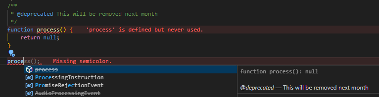

# Mark methods as deprecated properly

When method should be deprecated, use JSDoc params to mark it as deprecated with some description

```js
/**
 * @deprecated This will be removed next month
 */
function process() {
	return null;
}
```

Then when someone tries to use this method, it will be strikethrough in autocomplete popup. See VS Code example below.


